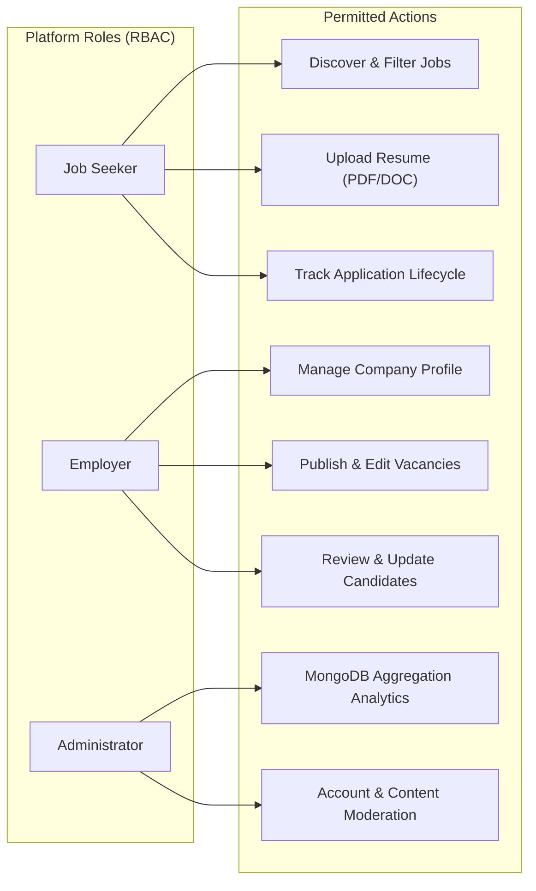
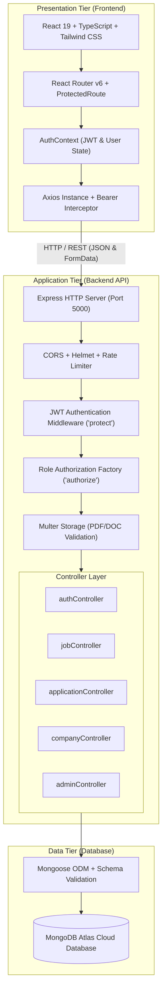
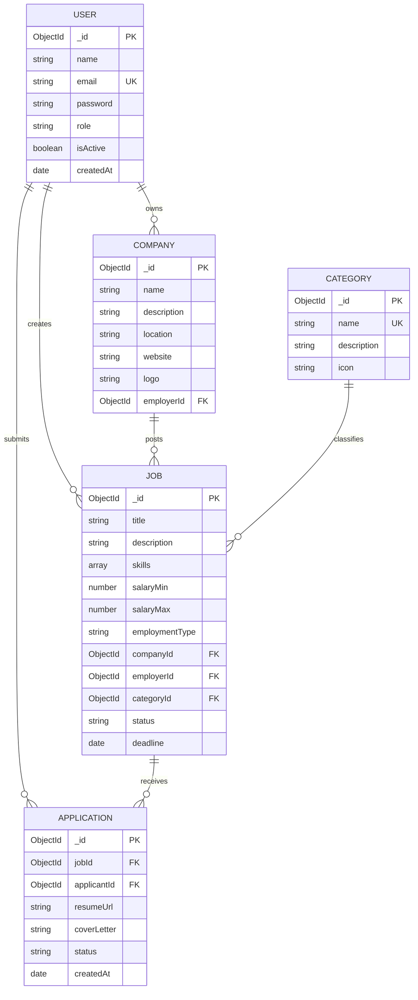
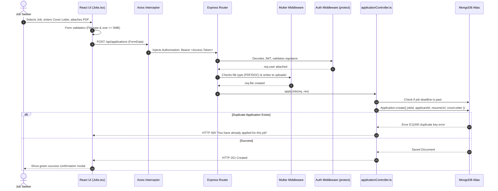

# System Design Document (SDD)
## Job Portal & Application Management System
**CDAC Full Stack Web Development Project**  
*Document Version: 1.0.0 | Date: November 2026*  
*Tech Stack: React 19, TypeScript, Tailwind CSS, Node.js, Express, MongoDB Atlas, JWT*

---

## 1. Executive Summary & Problem Statement

### 1.1 Overview
The **Job Portal & Application Management System** is an enterprise-grade, full-stack recruitment platform engineered to streamline hiring workflows between **Job Seekers** and **Employers**, moderated by an **Administrator**. 

### 1.2 Problems Addressed
- **Recruitment Bottlenecks**: Traditional email-based resume submissions lack status visibility and lead to disorganized applicant management.
- **Duplicate Application Flooding**: Without engine-level constraints, candidates frequently submit duplicate applications for the same opening.
- **Role Isolation & Security Gaps**: Fragmented authentication models expose administrative operations to privilege escalation.
- **Analytics Inefficiency**: Inability to generate real-time metrics on platform throughput without expensive client-side aggregations.

### 1.3 Solution Architecture
The application addresses these challenges through a decoupled **3-Tier MERN Architecture** with TypeScript type safety across both frontend and backend layers, compound unique database constraints, and server-side MongoDB aggregation pipelines.

---

## 2. Requirements Specification (SRS Mapping)

### 2.1 User Personas & Role Matrix



### 2.2 Functional Requirements (FR)
- **FR-01 (Authentication & Session)**: Support registration, authentication, and token refreshing using JWT access/refresh tokens and bcrypt password hashing.
- **FR-02 (Role-Based Routing)**: Prevent unauthorized route access using both client-side route guards (`ProtectedRoute.tsx`) and backend middleware (`protect`, `authorize`).
- **FR-03 (Job Discovery & Search)**: Multi-parameter search supporting text regex on job title/skills, category filtering, employment type, location, and server-side pagination.
- **FR-04 (Application Submission)**: Enable multi-part file uploads (`multipart/form-data`) supporting resume documents with MIME validation.
- **FR-05 (Duplicate Application Guard)**: Enforce a single application per candidate per job vacancy at the database engine layer.
- **FR-06 (Employer Hiring Pipeline)**: Provide employers with candidate listing, resume downloads, and atomic status transitions (`pending` $\rightarrow$ `shortlisted` $\rightarrow$ `selected` / `rejected`).
- **FR-07 (Company Profile Management)**: Enable employers to register and update their organization credentials, logo, and contact details.
- **FR-08 (Administrator Analytics)**: Compute aggregate distributions for platform accounts, vacancies, and application outcomes directly in MongoDB.
- **FR-09 (Moderation Engine)**: Allow administrators to activate/suspend user accounts and approve/reject job postings.

### 2.3 Non-Functional Requirements (NFR)
- **Performance**: Sub-100ms API response times on indexed queries; optimized static bundle via Vite and Tailwind utility compilation.
- **Security**: Zero plain-text storage of credentials, CORS domain restrictions, Helmet HTTP headers, and upload MIME sanitization.
- **Data Integrity**: Enforced through Mongoose schemas and compound unique indexing (`{ jobId: 1, applicantId: 1 }`).
- **Usability & Responsiveness**: Mobile-first responsive UI supporting both light and dark display modes.

---

## 3. High-Level System Architecture (HLD)

### 3.1 3-Tier Decoupled Architecture



### 3.2 Request-Response Lifecycle
1. **User Action**: The client triggers a user action (e.g., job application submission).
2. **Client Interceptor**: The Axios client automatically injects the stored JWT token into the `Authorization: Bearer <token>` header.
3. **Security Middleware**: Express validates origin (CORS) and injects secure headers (Helmet).
4. **Token Verification**: The `protect` middleware decodes the JWT, verifies its signature using `JWT_SECRET`, and attaches the active user payload to `req.user`.
5. **RBAC Verification**: The `authorize(...roles)` middleware checks whether `req.user.role` has the required privilege.
6. **Controller Execution**: The controller executes business logic, invokes Mongoose queries, and handles exceptions.
7. **Database Engine**: MongoDB performs atomic transactions or pipeline aggregations and returns structured BSON/JSON.

---

## 4. Low-Level Design (LLD) & Data Modeling

### 4.1 Entity-Relationship Diagram (ERD)



### 4.2 Detailed Schema Specifications & Indexes

#### 1. User Schema (`server/src/models/User.ts`)
- **Key Fields**: `name`, `email` (unique index, trimmed, lowercase), `password` (bcrypt hash), `role` (`'jobseeker' | 'employer' | 'admin'`), `isActive` (boolean, default: `true`).
- **Hooks**: Mongoose `pre('save')` hook hashes new or modified passwords using a 10-round cryptographic salt (`bcrypt.genSalt(10)`).

#### 2. Job Schema (`server/src/models/Job.ts`)
- **Key Fields**: `title`, `description`, `skills` (`[String]`), `salaryMin`, `salaryMax`, `employmentType` (`'full-time' | 'part-time' | 'contract' | 'internship'`), `companyId` (ref `Company`), `employerId` (ref `User`), `categoryId` (ref `Category`), `status` (`'pending' | 'approved' | 'rejected'`), `deadline` (Date).
- **Index**: Compound text index on `{ title: 'text', description: 'text', skills: 'text' }` for search speed.

#### 3. Application Schema (`server/src/models/Application.ts`)
- **Key Fields**: `jobId` (ref `Job`), `applicantId` (ref `User`), `resumeUrl` (String), `coverLetter` (String), `status` (`'pending' | 'shortlisted' | 'selected' | 'rejected'`).
- **Engine-Level Unique Constraint**:
  ```ts
  applicationSchema.index({ jobId: 1, applicantId: 1 }, { unique: true });
  ```
  > [!IMPORTANT]
  > This compound unique index guarantees zero duplicate applications even during race conditions or multiple rapid clicks from the frontend.

---

## 5. RESTful API Contract Specification

| Method | Endpoint | Access Level | Request Payload | Response / Status |
| :--- | :--- | :--- | :--- | :--- |
| `POST` | `/api/auth/register` | Public | `{ name, email, password, role }` | `201 Created` + User profile |
| `POST` | `/api/auth/login` | Public | `{ email, password }` | `200 OK` + Access & Refresh Tokens |
| `POST` | `/api/auth/refresh` | Public | `{ refreshToken }` | `200 OK` + New Access Token |
| `GET` | `/api/jobs` | Public | Query: `?search=&category=&page=&limit=` | `200 OK` + Paginated job array |
| `GET` | `/api/jobs/:id` | Public | URL Param: `id` | `200 OK` + Job details with Company |
| `POST` | `/api/jobs` | Employer | Job attributes JSON | `201 Created` + Created Job |
| `PUT` | `/api/jobs/:id` | Employer | Updated Job attributes | `200 OK` + Updated Job |
| `DELETE` | `/api/jobs/:id` | Employer / Admin | URL Param: `id` | `200 OK` + Deletion confirmation |
| `POST` | `/api/applications` | Job Seeker | `multipart/form-data` (`jobId`, `resume`, `coverLetter`) | `201 Created` + Application object |
| `GET` | `/api/applications/my` | Job Seeker | Header: `Bearer <token>` | `200 OK` + User's submitted applications |
| `GET` | `/api/applications/job/:id` | Employer | URL Param: `id` | `200 OK` + Candidates list with resume links |
| `PATCH` | `/api/applications/:id/status` | Employer | `{ status: 'shortlisted' \| 'selected' \| 'rejected' }` | `200 OK` + Updated Application |
| `GET` | `/api/admin/dashboard` | Admin | Header: `Bearer <token>` | `200 OK` + MongoDB Aggregation Metrics |
| `PATCH` | `/api/admin/users/:id/status` | Admin | `{ isActive: boolean }` | `200 OK` + Updated User State |

---

## 6. End-to-End Sequence Workflows

### 6.1 Job Application Workflow with Resume Upload



### 6.2 Administrator Dashboard Aggregation Pipeline

The dashboard metrics are computed directly by the database engine without memory overhead:

```ts
// User distribution aggregation
const userStats = await User.aggregate([
  {
    $group: {
      _id: "$role",
      count: { $sum: 1 },
    },
  },
]);

// Application status pipeline
const applicationStats = await Application.aggregate([
  {
    $group: {
      _id: "$status",
      count: { $sum: 1 },
    },
  },
]);
```

---

## 7. Security & Authentication Architecture

1. **Dual Token Life Cycle**:
   - **Access Token**: Short-lived (15 minutes), signed with `JWT_SECRET`, transmitted in HTTP Bearer headers.
   - **Refresh Token**: Long-lived (7 days), signed with `JWT_REFRESH_SECRET`, used solely to obtain new access tokens without prompting re-login.
2. **Password Cryptography**:
   - Enforced by `bcryptjs`. Passwords undergo salting ($2^{10}$ iterations) before storage. Plain-text passwords never touch disk.
3. **Role-Based Access Control (RBAC)**:
   - Declarative route security: `router.use(protect, authorize('admin'))`.
   - Prevents privilege escalation even if API routes are probed directly.
4. **File Upload Hardening**:
   - Multer configuration strictly filters MIME types (`application/pdf`, `application/msword`, `application/vnd.openxmlformats-officedocument.wordprocessingml.document`).
   - File names are generated using timestamp prefixes and random hashes to prevent directory traversal and collision attacks.

---

## 8. UI/UX Component & Layout Design System

### 8.1 Theming & Visual Tokens
- **Design Tokens**: Configured in `tailwind.config.js`.
- **Palette**:
  - Primary Brand Action: `brand-600` (`#059669` Emerald Green) & `brand-500` (`#10b981` Mint Green)
  - Secondary Accents: `teal-600` (`#0D9488` Teal) & `amber-500` (`#F59E0B` Warm Amber)
  - Light Mode Base: `bg-stone-50` with warm neutral surfaces (`bg-white/90`)
  - Dark Mode Base: `bg-[#0c1017]` (Deep Obsidian Night) with frosted emerald card borders
  - Card Glassmorphism: `glass-panel` backdrop-filter blur ($12\text{px}$) with subtle emerald halo
- **Responsive Breakpoints**:
  - `sm` ($640\text{px}$): Single-column cards collapse to compact horizontal lists.
  - `md` ($768\text{px}$): Filter drawer switches to stationary sidebar.
  - `lg` ($1024\text{px}$): 3-column job grid with fixed dashboard analytics navigation.

### 8.2 Application Route Map

```
/
├── / (Home / Landing Page)
├── /jobs (Job Search, Discovery & Apply Modal)
├── /login (Authentication with 1-Click Evaluation Demo buttons)
├── /register (Candidate & Employer Registration)
│
├── [Job Seeker Guard]
│   └── /dashboard (Track Applied Vacancies & Status Stepper)
│
├── [Employer Guard]
│   └── /employer (Company Profile, Post Vacancy, Candidate Review)
│
└── [Admin Guard]
    └── /admin (MongoDB Aggregations, User Toggle, Job Moderation)
```

---

## 9. Viva Defense & Evaluation Cheat Sheet (Sections 13 & 14)

| Evaluation Question | Target Source File | Key Architectural Talking Point |
| :--- | :--- | :--- |
| **"How is database connectivity managed?"** | [`server/src/config/db.ts`](server/src/config/db.ts) | Encapsulated async `connectionDB` with explicit `try...catch` and `process.exit(1)` fail-fast behavior. |
| **"How do you stop duplicate applications?"** | [`server/src/models/Application.ts`](server/src/models/Application.ts) | Compound unique index `applicationSchema.index({ jobId: 1, applicantId: 1 }, { unique: true })`. |
| **"How are user passwords protected?"** | [`server/src/models/User.ts`](server/src/models/User.ts) | Mongoose `pre('save')` hook with `bcrypt.genSalt(10)` and `bcrypt.hash()`. |
| **"Explain your RBAC security model."** | [`server/src/middleware/auth.ts`](server/src/middleware/auth.ts) | Two-tier middleware: `protect` (verifies JWT signature) + `authorize(...roles)` (enforces role match). |
| **"Where did you utilize MongoDB Aggregation?"** | [`server/src/controllers/adminController.ts`](server/src/controllers/adminController.ts) | Native `$group` and `$sum` pipelines compute live dashboard metrics in-engine rather than in application memory. |
| **"How does the frontend communicate securely?"** | [`client/src/services/api.ts`](client/src/services/api.ts) | Axios request interceptor injects `Authorization: Bearer <token>`; response interceptor clears expired sessions on 401. |
