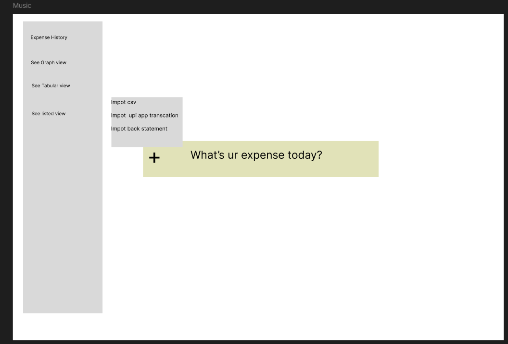
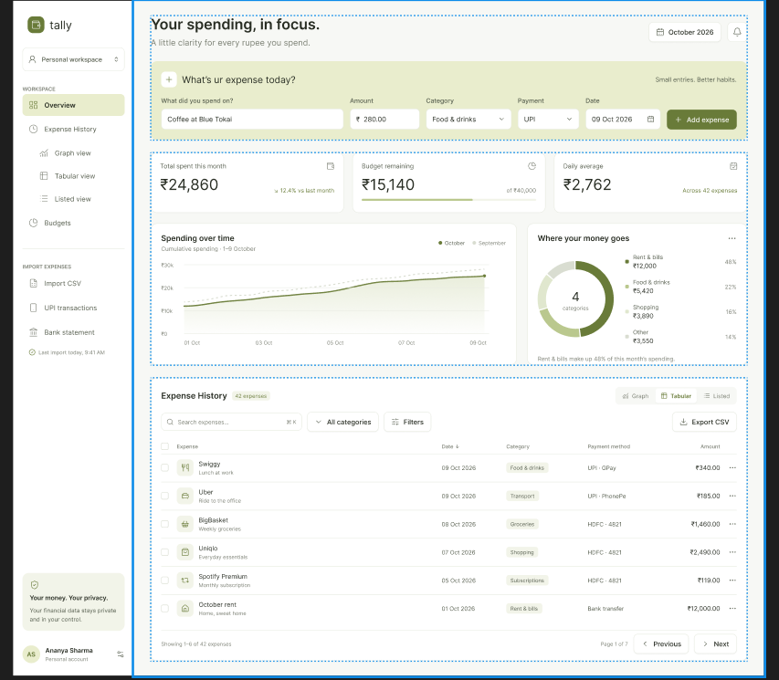

I have to build to  a expense tracker it should have ui like a this and very simple color schema 

 i have to use html css js , node and that the only thing i can use

 1. can build basic seleton with help of html  and css
 2. can implement basic functionality through the js 

 now the main concern is that i have to build the 

 BluePrint of making this project

 